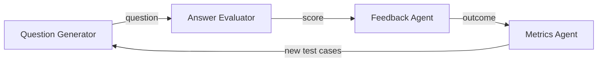

# interview-prep-agents

An open-source **multi-agent pipeline for interview practice**, built by the Leopard Community.

Four small agents each do one job and pass their results along:



| Agent | Job | Lives in |
|---|---|---|
| Question Generator | Creates interview questions by topic and difficulty | `src/interview_prep/agents/question_generator.py` |
| Answer Evaluator | Scores a practice answer against a rubric | `src/interview_prep/agents/answer_evaluator.py` |
| Feedback Agent | Turns a score into specific, actionable feedback | `src/interview_prep/agents/feedback.py` |
| Metrics Agent | Logs outcomes and feeds new test cases back to the generator | `src/interview_prep/agents/metrics.py` |

The shared data types the agents pass to each other are in `src/interview_prep/models.py`. **Agree on changes there with the other teams first.** It's the contract that holds the pipeline together.

> **Status:** early scaffold. The pipeline defaults to deterministic mock clients and placeholder output.
> Model-backed agents can opt into OpenAI or local Ollama; agent teams own prompt and evaluation quality.

## Quick start

```bash
git clone https://github.com/GoNextPath/interview-prep-agents.git
cd interview-prep-agents
python -m venv .venv && source .venv/bin/activate
pip install -e ".[dev]"

pytest                     # run the tests
python -m interview_prep   # run one question through the whole pipeline
```

Requires Python 3.10+. No API credentials are needed for tests or the default pipeline.

## Development commands

Run `make help` (or just `make`) to discover available commands:

```sh
make check             # Ruff and offline tests
make run-mock          # Quiet interactive mock round
make run-ollama        # Interactive Ollama round; progress on stderr
make trace-mock        # Mock diagnostics and console tracing
make trace-ollama      # Ollama diagnostics and console tracing
make clean-logs        # Remove local .log files (clean is an alias)
make test-live-list    # Inspect live tests without model calls
make test-live         # Real OpenAI calls; may incur charges
```

The Makefile uses `.venv/bin/python` when available, otherwise `python3`. Override it with
`make test PYTHON=/path/to/python`. Set application logging with `make trace-ollama IP_LOG_LEVEL=DEBUG`.
Install `.[dev]` for checks, `.[telemetry]` for tracing, and `.[openai]` for live OpenAI tests.
Before using Ollama, start its server and pull/warm the model named in the registry's `local`
entry; see the [Ollama walkthrough](docs/llm.md#logging-and-an-ollama-trace). Both run targets
use `WARNING` logging and disable telemetry. Mock runs hide progress chatter; Ollama runs keep
progress updates visible. Trace targets use `INFO` logging and enable console spans.

Questions, answer prompts, feedback, and brief failure notices go to stdout. Logs, progress updates, and console spans
go to stderr. Capture diagnostics without mixing them into the practice output:

```sh
mkdir -p logs
make trace-mock 2> logs/mock.log
make trace-ollama 2> logs/ollama.log
```

If a round fails, the practice output shows a brief notice even with diagnostics redirected.
Check the log for the detailed error; response validation names the invalid field without
recording its contents.

Both Ollama targets default to a 120-second network timeout and 10-second waiting updates;
override with `make run-ollama IP_TIMEOUT_SECONDS=180 IP_PROGRESS_INTERVAL=5`. See
[progress and UI integration](docs/llm-architecture.md#progress-and-ui-integration) for the callback API.
Local `.log` files and `logs/` are Git-ignored. `make clean` deletes root-level `.log` files and
`.log` files recursively under `logs/`, preserving other files and directories.
Make is optional; the underlying Python commands remain available in the documentation.

## Model configuration

Each model-backed agent accepts an injected client and can independently select a registered
model. `LLM_MODE=mock` forces credential-free mocks; metrics always uses Python logic.
See [model configuration](docs/llm.md) for hosted/local setup, external deployment configuration,
provider extensions, and troubleshooting. The guide includes a
[code organization map](docs/llm-architecture.md#code-organization), [CLI options](docs/llm.md#cli-options),
and an [Ollama trace walkthrough](docs/llm.md#logging-and-an-ollama-trace).
[ADR 0001](docs/adr/0001-configurable-llm-clients.md) records the proposed decisions.

## Repo layout

```
src/interview_prep/
  __main__.py        # CLI parsing, configuration, and practice-round entry point
  models.py          # shared data types (the contract between agents)
  pipeline.py        # wires agents together and owns created clients
  agents/            # agents, agents.json assignments, and response validation
  progress/          # events, heartbeat reporting, and console rendering
  llm/
    contracts.py     # provider-independent request and client protocol
    factory.py       # client creation and cleanup
    options.py       # runtime timeout and heartbeat options
    models.json      # development model definitions and default
    providers/       # OpenAI, Ollama, and mock clients
    registry/        # loading, selection, and configuration validators
    telemetry/       # tracing, logging, exporters, and observed-client wrapper
tests/               # default offline tests, including recorded provider transports
integration_tests/   # separately invoked live-provider smoke tests (may incur charges)
evals/               # evaluation harness and datasets
notebooks/           # example notebooks
docs/                # design doc, MVP, milestones, decisions
```

## Teams

Each area has a small sub-team that stays with it for several weeks. See [`docs/teams.md`](docs/teams.md).

## Contributing

Start with [CONTRIBUTING.md](CONTRIBUTING.md). Contributing is optional and self-paced: help as much or as little as you like.

## Security

This project calls LLMs and is public, so prompt injection, untrusted model output, secrets and dependencies all need care. See [SECURITY.md](SECURITY.md).

## License

[MIT](LICENSE)
