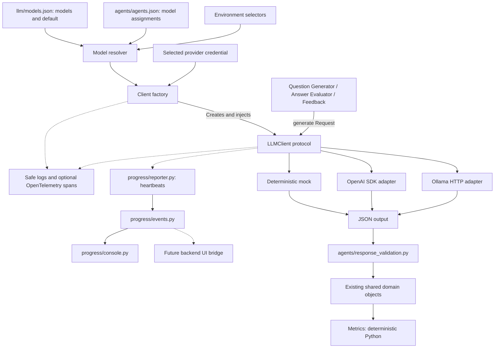
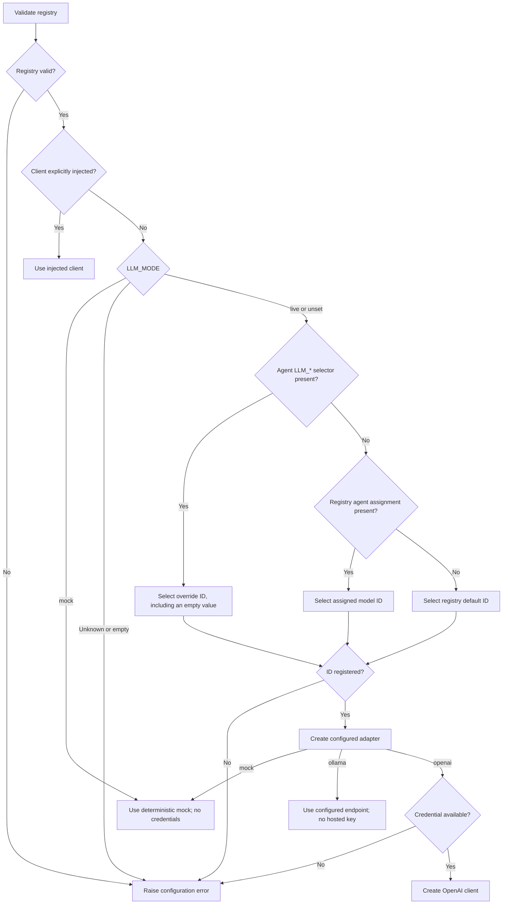

# ADR 0001: Configurable LLM clients and model registry

- Status: Proposed for team review
- Date: 2026-10-28
- Updated: 2026-10-29
- Related: [Issue #5](https://github.com/GoNextPath/interview-prep-agents/issues/5)

## Context

Three agents need independent model selection behind a shared interface. Contributors must
be able to run the pipeline and tests without credentials or model charges. Metrics currently
uses deterministic aggregation and does not need a model. Shared domain contracts must remain stable.

## Decision

**Registry.** Package `llm/models.json` with reusable model IDs, provider settings, and a mock
default. Keep agent-to-model assignments in `agents/agents.json`, alongside the agent modules.
Multiple IDs may use the same provider. Credentials
are referenced by environment-variable name; secrets never belong in JSON. Validate the entire
registry and agent assignments, including unselected entries, before resolving clients. Common
model fields and provider settings are validated by separate functions to keep loading readable.
The `llm/registry/` package separates loading, data types, agent/default references, and provider
validators; its `__init__.py` contains exports only.
The packaged files are development defaults; deployments may supply external files through
`--models-config` and `--agents-config`, or pass a loaded registry through the Python API. Missing
or invalid external files fail without falling back to packaged configuration.

**Environment precedence.** Resolve each model-backed agent at construction time:
`LLM_MODE=mock` → agent-specific `LLM_*` selector → registry agent assignment → registry default.
Selectors name registry IDs. Unset mode permits registry selections; checked-in selections are
all mocks. Unknown modes, empty/unknown selectors, and invalid mappings fail without a paid
fallback. Global mock mode ignores agent selectors and never requires credentials. Registry
structure must still be valid. Injected clients bypass selection for their agents.

**Provider abstraction.** Inject a small synchronous `LLMClient` protocol accepting a task,
system instruction, and JSON input and returning a JSON object. Agents validate generated fields
before building existing domain objects. The composition layer owns resolution and client creation;
provider adapters own SDK and transport details. Client creation and cleanup live in
`llm/factory.py`; `llm/__init__.py` only re-exports the public API. Provider clients live in
separate `llm/providers/openai.py`, `llm/providers/ollama.py`, and `llm/providers/mock.py` modules.
Shared generated-field validation lives in `agents/response_validation.py`. Start with deterministic
mocks, an optional native
OpenAI SDK adapter, and a small Ollama HTTP adapter. Keep metrics in Python. Provider dispatch
is explicit; an unsupported adapter fails configuration. Plain HTTP Ollama endpoints are restricted
to loopback; requests bypass environment proxies and reject redirects. The composition layer owns
and closes created clients; standalone model-backed agents also provide ownership-aware cleanup.
Injected clients remain owned by their caller.

Prefer native adapters over LiteLLM for this small provider surface: mock/local installs need no
runtime dependencies, and agents already have a stable application-owned interface. Reconsider
LiteLLM when additional providers make adapter maintenance costly. Async, streaming, usage metadata,
and generic typed schemas are deferred until needed; the existing pipeline is synchronous.

**Observability.** Use configurable Python logging and optional OpenTelemetry traces. Group
tracing, per-call context, the observed-client wrapper, exporter setup, and logging configuration
in separate modules under `llm/telemetry/`, with exports only in `__init__.py`. The CLI
owns SDK/exporter setup and shutdown; library imports never start exporters. Console export
requires no account, and OTLP/HTTP export is explicit opt-in. A practice-round parent span groups
client selection and generation spans, recording agent, registry ID, provider, requested/actual
model, timing, and outcome. Logs include trace IDs for correlation. Keep prompts, interview
answers, generated content, credentials, and raw exceptions out of telemetry. Log levels and
trace sampling are independent controls. SDK dependencies remain optional, with in-memory
exporter tests. Send logs and console spans to stderr, with questions and feedback on stdout.
Ordinary run targets use WARNING logging with telemetry off; separate trace targets enable INFO
logging and console export. Progress also uses stderr and is hidden for the quiet mock target.
Keep answer prompts and brief round-failure notices on stdout so redirected diagnostics do not
hide the interaction or failure. Detailed validation errors identify field paths without values.
Local log artifacts are Git-ignored and removable with `make clean`. Evaluation storage and
telemetry metrics are separate follow-up work.

**Progress and UI boundary.** Group event definitions, heartbeat reporting, and CLI rendering in
separate modules under `interview_prep/progress/`. Keep client runtime options in `llm/options.py`.
Add an optional content-free progress callback around shared model
calls, with configurable waiting intervals and network timeouts. Events carry a per-call ID,
agent/model identity, elapsed time, and lifecycle phase. A helper thread emits waiting events
while the synchronous provider call is blocked and stops before the terminal event. Callbacks
must be nonblocking and thread-safe; observer errors do not replace model results. The CLI renders
these events, while a future web layer can forward them to a UI without changing agent result
contracts. The web layer owns session isolation and overall result/error delivery. Progress does
not require token streaming and does not imply a percentage complete or cancellation support.

**CLI boundary.** Keep argument definitions in `build_parser()` and flag/environment resolution
in `main()`. Pass the resulting registry, runtime options, and round inputs explicitly to
`run_round()`, which owns its pipeline through a context manager. CLI rendering consumes progress
events without adding presentation behavior to provider adapters.

### Client architecture

The factory supplies each model-backed agent with an adapter implementing the same protocol.
Agents validate its JSON output before constructing shared domain objects.

### Selection precedence

Registry validation runs first. Selection happens once for each agent being constructed;
explicitly injected clients bypass that agent's environment and registry selection.

## Consequences

Agents can mix mocks, hosted models, and local models without changing business logic. Each
adapter needs transport tests, and JSON mode still requires domain validation. Mock fixtures
preserve the scaffold behavior; they do not assess real answer quality. Question IDs remain
unique, while mock client responses are deterministic for the same input.

Ordinary tests inject clients or select mocks and block network access, including localhost.
Collection is always guarded, even with live opt-in; credentials and network access are restored
only during authorized integration setup/execution/teardown and then guarded again.
CI also forces mock mode. A separate live-provider integration suite is excluded from default
collection and requires explicit opt-in outside CI. Root/IDE discovery deselects live tests without
opt-in rather than aborting offline checks. Missing credentials,
provider failures, refusals, truncated responses, and invalid output raise errors without retrying
or switching providers. Application errors do not include credentials or interview contents. Trace failures record
only the error type and status; application log levels do not enable provider SDK body logging.
